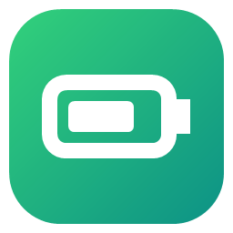
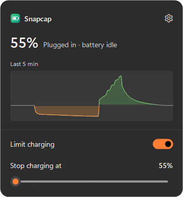
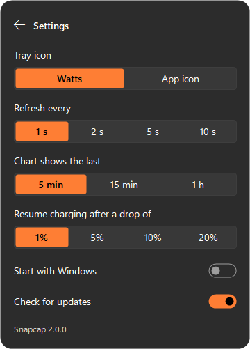

# Snapcap

Snapcap stops your Snapdragon X laptop from charging past a level you choose, such as 80%. Keeping the battery below full while the laptop stays plugged in helps it last longer.

Windows and most laptop apps don't offer this option on Snapdragon laptops, even though the battery supports it. Snapcap adds it, in a small panel next to the clock.

  
  

## Download

Get it from [Releases](../../releases). There are two versions:

- **Snapcap-Setup.exe** (recommended) installs Snapcap and starts it every time you sign in. Windows asks for permission once, during setup, and never again.
- **Snapcap-Portable.exe** runs without installing. Windows asks for permission each time you change the limit.

Snapcap needs a laptop with a Snapdragon X processor and Windows 11. It has been tested on a Lenovo Yoga Slim 7x. Other Snapdragon X laptops will probably work too; please [open an issue](../../issues) to say whether yours does.

## How to use it

Click the Snapcap icon next to the clock to open the panel:

- Turn on **Limit charging** and pick where charging should stop. Once the battery gets there, the laptop runs straight from the charger and the battery stays put.
- The **chart** shows the battery's power over the last few minutes: green while it charges, orange while it drains, grey while it rests. Point at it to see the exact time and value.

The limit stays in place after restarts, even if you turn Snapcap off or uninstall it. To charge to 100% again, turn **Limit charging** off.

Click the **gear** for settings:

- **Tray icon**: show the battery's power in watts (the default) or the Snapcap icon. The watts are what goes into or out of the battery, so a power meter on the charger will show more, since the charger also runs the laptop.
- **Refresh every**: how often the numbers and the chart update.
- **Chart shows the last**: 5 minutes, 15 minutes or 1 hour.
- **Resume charging after a drop of**: if you unplug and use the battery for a while, how far below the limit it has to drop before it charges again. 1% keeps it right at the limit; a larger number avoids lots of tiny top-ups.
- **Start with Windows** and **Check for updates** are on by default. When a new version is out, a small notice appears at the bottom of the panel.

To close Snapcap, right-click its icon and choose **Exit**. To uninstall it, go to **Settings › Apps**.

## Questions

**Snapcap says it can't find the driver.** It only works on laptops with a Snapdragon X processor.

**My laptop is stuck at 60% or 80% after using Linux.** That's the same setting. Linux saves it in the battery, and Snapcap can change or remove it.

**Is it safe?** Snapcap uses the same battery setting that Linux uses on these laptops. Still, it comes with no warranty.

## License

[MIT](LICENSE). For developers: [technical notes](docs/technical.md).
