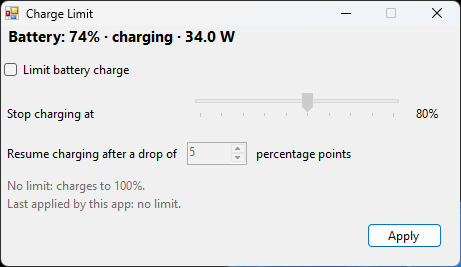

# Snapdragon Charge Limit

A tiny (~15 KB) Windows app that sets a battery charge limit on Snapdragon X laptops, such as stopping at 80% while the laptop stays plugged in.

On these machines the limit lives in the Qualcomm battery-manager firmware. Linux can set it (GNOME's "Preserve Battery Health" setting does), but on Windows the vendor apps often don't show it. Lenovo Vantage, for example, looks for a Lenovo "Energy Management" driver that doesn't exist on Snapdragon models. Because the firmware keeps the value across reboots and operating systems, a limit set from Linux can leave a laptop stuck at 60–80% in Windows with no way to undo it. This app lets you set it, change it and remove it from Windows.



## Requirements

- A Snapdragon X (X1E/X1P) laptop running Windows 11 with Qualcomm's PMIC GLink driver (`qcpmicglink8380.sys`). The app checks for it at startup.
- Administrator rights (the app asks through UAC).
- .NET Framework 4.8.1, which is built into Windows 11. Nothing to install.

Tested on a Lenovo Yoga Slim 7x 14Q8X9 (83ED). Other Snapdragon X laptops use the same Qualcomm driver and will probably work. Please open an issue with your model either way.

## Usage

Download `ChargeLimit.exe` from [Releases](../../releases) and run it. It's a single portable file with no installer.

- **Limit battery charge**: turns the limit on.
- **Stop charging at**: 55–100%.
- **Resume charging after a drop of**: how many points below the limit charging starts again. The default is 5, so a limit of 80% resumes charging below 75%.
- **Apply**: sends the setting to the firmware. It takes effect right away, survives reboots, and also applies in Linux.

Untick the box and press **Apply** to charge to 100% again.

### Command line

Useful for Task Scheduler or scripts. The app shows no window in this mode, and the exit code is `0` on success or a Win32 error code (`87` means invalid arguments).

```bat
ChargeLimit.exe --set 80
ChargeLimit.exe --set 80 --delta 10
ChargeLimit.exe --off
```

## How it works

Qualcomm's `qcpmicglink` driver exposes `\\.\QCOMBATTMGR`. That device translates IOCTL `0x80092044` into the battery-manager firmware request `BATTMGR_CHG_CTRL_LIMIT_EN` (opcode `0x48`) and sends it to the ADSP over PMIC GLink. The input is three `uint32` values:

| Offset | Field        | Value                                     |
|--------|--------------|-------------------------------------------|
| 0      | `enable`     | always `1`                                |
| 4      | `target_soc` | stop charging at this % (`100` = no limit) |
| 8      | `delta_soc`  | resume charging at `target_soc - delta_soc` |

Linux's [`qcom_battmgr`](https://github.com/torvalds/linux/blob/master/drivers/power/supply/qcom_battmgr.c) driver sends the same request for `charge_control_end_threshold`, and this app uses the same bounds: stop at 55–100%, resume no lower than 50%.

The firmware doesn't report the current limit back through this interface, so the app remembers what it last applied in `HKCU\Software\ChargeLimit`. Battery status comes from the standard Windows battery class IOCTLs.

The IOCTL was found by reverse engineering the Windows driver. It isn't documented by Qualcomm and could change with a driver update. In that case the request would most likely just fail.

## Building

```bat
build.cmd
```

This compiles `bin\ChargeLimit.exe` with the `csc.exe` that ships with the .NET Framework in Windows. No SDK or Visual Studio is needed. The code is C# 5 (the most recent version that compiler supports) and has no dependencies.

## Disclaimer

This sends an undocumented command to your battery firmware. It's the same command Linux uses, but there is no warranty. Use it at your own risk.

## License

[MIT](LICENSE)
